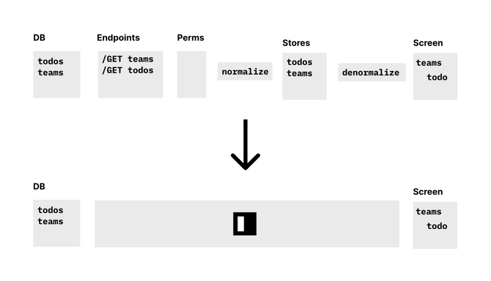
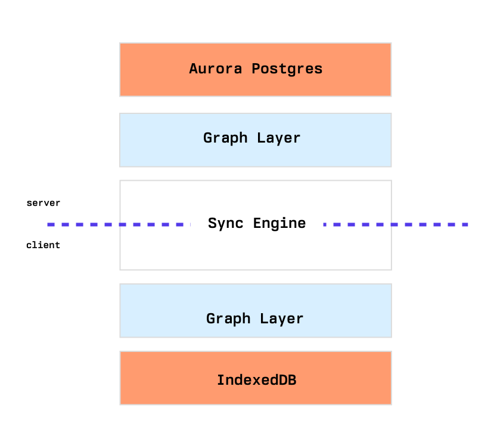

<!-- SidekickDB: plain-text header in place of upstream's logo, badges and links. -->
# SidekickDB

SidekickDB is a realtime database with a sync engine that you can host yourself.

SidekickDB is an independent continuation of the Apache-2.0 InstantDB code. It is not affiliated with or endorsed by Instant. See [UPSTREAM.md](./UPSTREAM.md) for where the code comes from and what differs.

SidekickDB gives your app a database it can use from the client. You get auth, permissions, storage, presence, and streams.

You write [relational queries](./client/www/app/docs/instaql/page.md) in the shape of the data you want, and SidekickDB handles the data fetching, permission checking, and offline caching. When you [change data](./client/www/app/docs/instaml/page.md), optimistic updates and rollbacks are handled for you as well. Every query is multiplayer by default.

[Ephemeral](./client/www/app/docs/presence-and-topics/page.md) updates, like cursors or who's online, are supported too. There are SDKs for [JavaScript](./client/www/app/docs/start-vanilla/page.md), [React](./client/www/app/docs/page.md), [React Native](./client/www/app/docs/start-rn/page.md), [Vue](./client/www/app/docs/start-vue/page.md), [Svelte](./client/www/app/docs/start-svelte/page.md) and [SolidJS](./client/www/app/docs/start-solidjs/page.md).

Here is a barebones chat app in about 12 lines:

```javascript
// ༼ つ ◕_◕ ༽つ Real-time Chat
// ----------------------------------
// * Updates instantly
// * Multiplayer
// * Works offline

import { init, id } from "@sidekickdb/react";

const db = init({ 
  appId: process.env.NEXT_PUBLIC_APP_ID,
});

function Chat() {
  // 1. Read
  const { isLoading, error, data } = db.useQuery({
    messages: {},
  });

  // 2. Write
  const addMessage = (message) => {
    db.transact(db.tx.messages[id()].update(message));
  };

  // 3. Render!
  return <UI data={data} onAdd={addMessage} />;
}
```

## Why a database on the client

Most apps start with the server: databases, caches, ORMs and endpoints. Then comes client-side code: stores, selectors and mutators. Then optimistic updates, offline support and realtime, each with its own machinery. Every new feature goes through the same steps again.

InstantDB's authors saw that most of this work is a database problem in disguise, and SidekickDB keeps their design.

<!-- SidekickDB: diagrams load from the copies in this repository, not from instantdb.com. -->
<p align="center">
  
</p>

With a database on the client you do not need stores, selectors, endpoints or local caches: you write queries. If queries are multiplayer by default, you do not think about stateful servers. If the database supports rollback, you get optimistic updates for free.

## Architectural Overview

<p align="center">
  
</p>

All user data is stored as triples in one Postgres database.

A sync server written in Clojure talks to Postgres. Its query engine understands datalog and [InstaQL](./client/www/app/docs/instaql/page.md), a relational language that looks a lot like GraphQL:

```javascript
// give me all users, their posts and comments
{
  users: {
    posts: {
      comments: {
      }
    }
  }
}
```

Taking inspiration from [Asana’s WorldStore](https://asana.com/inside-asana/worldstore-distributed-caching-reactivity-part-1) and [Figma’s LiveGraph](https://www.figma.com/blog/how-figmas-multiplayer-technology-works/#syncing-object-properties), the server tails Postgres’ WAL to detect novelty and invalidate the queries that are affected.

On the frontend there is a client-side triple store. The SDK persists a cache of recent queries to IndexedDB on web, and AsyncStorage in React Native.

All data goes through a permission system powered by Google's [CEL library](https://github.com/google/cel-java).

## Getting Started

SidekickDB is self-hosted. [`self-hosting/README.md`](./self-hosting/README.md) starts the stack with Docker Compose: the server, dashboard and Postgres images from `ghcr.io/sidekickdb`, plus RustFS for object storage.

The documentation is in this repository under [`client/www/app/docs`](./client/www/app/docs/page.md). [`RELEASING.md`](./RELEASING.md) says what is released and where.

Questions and bug reports go to [GitHub issues](https://github.com/SidekickDB/sidekick/issues). Report a vulnerability as [`SECURITY.md`](./SECURITY.md) describes, not in an issue.

## Contributing

See [`CONTRIBUTING.md`](./CONTRIBUTING.md). To run SidekickDB locally, start with the [`client`](./client/) and [`server`](./server/) READMEs.
